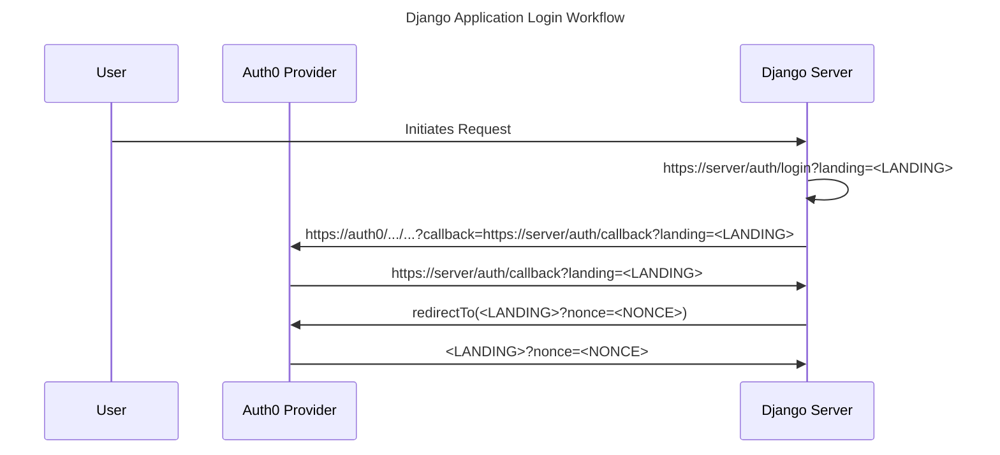

# Auth1: Auth0 Integration

The legacy `POST /app/auth1/session` claims relay is retired and returns
HTTP 410 with code `DIRECT_SESSION_RETIRED` and the configured backend login URL.
Posted identity dictionaries and the legacy `CLIENT_SESSION_API_KEY` cannot mint
or replace a session. This security boundary applies immediately, without an
insecure compatibility flag. Existing clients of that relay must switch to the
backend OAuth authorization-code flow; the current web and CLI already use it.

Begin at the backend `login` route. Authlib verifies the state-bound callback and
provider token before user registration, auto-join, group synchronization or
session creation. Existing verified sessions, CLI device approval and their
normal bearer/session admission continue to work. Do not roll back to unverified
claim admission; there is no safe legacy fallback.

## The session hand-off (#2429)

The callback never puts the session key in a URL. When the return address is
the frontend's `/auth/callback`, it appends a one-time `code`
(`auth1/handoff.py`): good once, for 60 seconds, and bound to the browser's
session cookie, which the same response sets. The frontend trades it at
`POST /app/auth1/handoff` with that cookie, the `X-Platform` header and no
`Authorization` header, and gets `{"Authorization": "Session <key>"}`. A page
on this host (the CLI device approval) gets no code: the cookie is enough.

## Verified addresses (#2430)

An identity reaches an account by its email, through an email match,
auto-signup or an invitation, so every sign-in needs the IdP's `email_verified`
claim to be `true`, or the string `"true"` Cognito sends for a mapped
attribute. Otherwise the browser goes back to sign-in with
`error=email_unverified`. A Cognito pool that federates (Google, SAML) must map
`email_verified` from the upstream provider; Cognito sends `false` for an
unmapped one.

